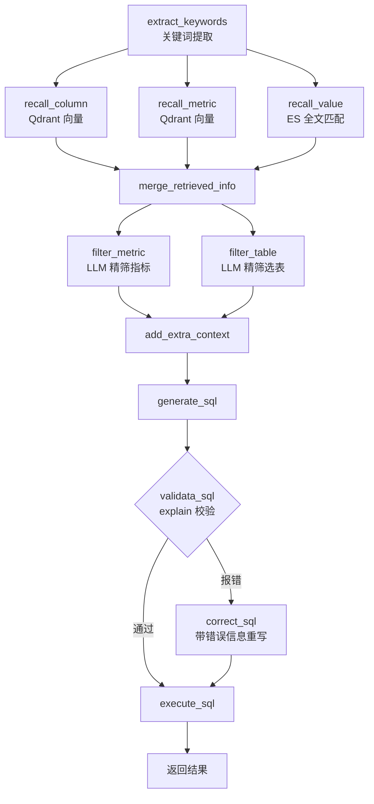

# 仓配自助问数 LogiQL · 企业级 NL2SQL 智能问数系统

    

> 以**数据仓库元数据**为核心，用 LangGraph 编排多路召回与 SQL 生成，  
> 让用户用自然语言提问，系统自动产出可执行 SQL 并返回结果。

与「[履约知识助手 Warehouse-KB](https://github.com/winc-0/warehouse-kb)」（非结构化文档的 RAG 问答）配套：  
**履约知识助手管文档，仓配自助问数管数据**，共同覆盖 LLM 在企业内落地的两类主要场景。

## 关于这个仓库

**履约知识助手是一个完整可运行的 RAG 知识库系统，可按本文档在本地部署复现。** 要点：

- 检索主链路基于 LangGraph 编排：多格式文档导入 → 三路混合召回 → RRF 融合 → 精排 → SSE 流式问答。
- 自带一套离线评测体系（`eval/`）：六组策略消融、配对 bootstrap、全局检索对照与标注集构建工具。
- **评测数字都是实际跑出来的**，`eval/results/` 与 `eval/README.md` 里有对应的报告与复现命令，任何人都能按文档复跑核对。

## 目录

- [项目简介](#项目简介)
- [架构](#架构)
- [技术栈](#技术栈)
- [快速开始](#快速开始)
- [端到端验证记录](#端到端验证记录)
- [NL2SQL 评测](#nl2sql-评测)
- [目录结构](#目录结构)
- [Roadmap](#roadmap)
- [已知限制](#已知限制)
- [开源协议](#开源协议)

## 项目简介

面向仓配履约数据仓库（Data Warehouse）场景的 ChatBI 系统。核心是 **NL2SQL**——把"上个月华北仓的出库及时率是多少"这类自然语言，转换成语法正确、口径准确的 SQL。

NL2SQL 的难点不在"写 SQL"，而在三件事：

1. **选对表**：企业数仓几十上百张表，先要找到相关的那几张
2. **对齐口径**：业务说"妥投率"，可能是按时妥投还是最终妥投、是否剔除拒收件，必须按指标定义来
3. **精确匹配取值**：用户说"华北仓"，库里存的是 `warehouse_name = '华北1仓'`，字面不一致会生成错误的 WHERE 条件

本系统围绕这三点设计：用**元数据知识库**承载表/字段/指标定义，用**三路异构召回**解决选表与取值匹配，用**指标口径注入 + SQL 校验纠错**保证生成质量。

## 架构

### 元数据知识库

元数据库共 4 张表，是系统的语义基础设施：

| 表               | 作用                                                  |
| --------------- | --------------------------------------------------- |
| `table_info`    | 表描述（业务含义、用途）                                        |
| `column_info`   | 字段描述 + **列角色**（主键 / 外键 / 度量 measure / 维度 dimension） |
| `metric_info`   | **指标定义**：业务口径、计算逻辑、关联列、别名                           |
| `column_metric` | 字段与指标的关联关系                                          |

指标单独建模是关键——"出库及时率""妥投率"这类业务口径无法用单个字段表达，必须人工补充计算逻辑。

### 三路异构召回

| 召回路             | 存储               | 解决什么                                    |
| --------------- | ---------------- | --------------------------------------- |
| `recall_column` | Qdrant 向量        | 语义匹配相关**字段**（"出了多少单" → `outbound_cnt`）   |
| `recall_metric` | Qdrant 向量        | 语义匹配**指标定义**（口径、计算逻辑）                   |
| `recall_value`  | Elasticsearch 全文 | **维度取值精确匹配**（"华北仓" → `warehouse_name='华北1仓'`） |

第三路是最容易被忽略却最致命的一环：用户说的词和库里存的值对不上，生成的 WHERE 条件必然是错的。

### 自建数据仓库

90 天日期与 115 笔出库单，时间跨度不足以支撑「月度趋势 / 季度对比 / 年度同比」这类最常见的问数诉求，评测也拿不到区分度。
因此改用 `scripts/gen_dw_data.py` 自建 24 个月的仓配履约数据：

| 表               | 内容                              |
| --------------- | ------------------------------- |
| `dim_date`      | 731 天（2024-01-01 ~ 2025-12-31）  |
| `fact_outbound` | 2537 笔出库单                       |
| `dim_cargo`     | 15 类货品，6 个品类 / 14 个货主            |
| `dim_shipper`   | 20 个货主，4 档合作等级                   |
| `dim_warehouse` | 6 个仓，5 个大区                       |
| `dim_carrier`   | 8 家承运商，3 档时效产品                   |

生成过程不是纯随机，而是按仓配履约业务的真实形态建模，每条规则都能对应一个业务假设：

- **季节性**：Q4 受双十一与年货节拉动（系数 1.3），2 月受春节休假拖累（0.7）
- **品类单重带**：3C 数码单均 0.8kg 且单票 1-2 件，快消食品单均 6kg 但单票 10-30 件
- **仓区权重**：华东 0.28 > 华南 0.22 > 华北 0.20 > 华中 0.16 > 西南 0.14
- **货主倾向**：战略客户的出库单量权重是普通客户的 3 倍
- **时效分层**：不同承运商时效产品的妥投时长基准不同，用于构造"同一问题、不同口径"的辨析场景
- **年度增长**：2025 年整体比 2024 年增长约 25%

固定随机种子，同一份代码永远产出同一份数据，评测结果可复现。

```bash
python scripts/gen_dw_data.py            # 重新生成 docker/mysql/dw_expand.sql
```

### 智能体流程（LangGraph）



SQL 校验用 `EXPLAIN` 预执行，失败则把报错信息回灌给 LLM 重写一次。

## 技术栈

| 类别    | 选型                             |
| ----- | ------------------------------ |
| 工作流引擎 | LangGraph（12 节点，含并行分支与条件路由）    |
| 元数据存储 | MySQL 8（meta + dw 双库）          |
| 向量检索  | Qdrant（字段 / 指标语义召回）            |
| 全文检索  | Elasticsearch（维度取值匹配）          |
| 嵌入模型  | BAAI/bge-large-zh-v1.5（TEI 部署） |
| LLM   | OpenAI 兼容端点，默认阿里云百炼 DashScope  |
| 后端框架  | FastAPI                        |
| 包管理   | uv                             |

## 快速开始

### 1. 启动中间件

```bash
cd docker
cp .env.example .env
docker compose up -d     # 首次拉取镜像约 5-10 分钟
docker compose ps        # 等待各服务 healthy
```

| 服务              | 地址                                |
| --------------- | --------------------------------- |
| MySQL           | `localhost:3306`（自动初始化 meta / dw） |
| Elasticsearch   | `localhost:9200`                  |
| Kibana          | `http://localhost:5601`           |
| Qdrant          | `localhost:6333`                  |
| Embedding (TEI) | `localhost:8081`                  |

### 2. 配置应用

```bash
cp .env.example .env     # 填入 LLM_API_KEY 等
```

配置文件为 `conf/app_config.yaml`，敏感值均通过 `oc.env` 从环境变量注入，不硬编码。

### 3. 安装与运行

```bash
# 依赖安装（Windows 上 uv 构建 antlr4-python3-runtime 源码包可能失败，可改用 pip）
uv sync

# 或：python -m venv .venv && .venv/Scripts/pip install -e .

# 说明：仓库内的 uv.lock 由开发环境生成。若 pyproject.toml 的依赖有变更，
# uv sync 会自动重新解析并更新锁文件（需要联网）；想完全锁死可加 --frozen。

# 构建元数据知识库：把 conf/meta_config.yaml 的表/字段/指标写入 MySQL，
# 并同步到 Qdrant（字段、指标向量）与 ES（字段取值全文索引）
python -m app.scripts.build_meta_knowledge -c conf/meta_config.yaml

# 启动服务（--env-file 让 OmegaConf 的 oc.env 能读到 .env）
uvicorn main:app --port 8010 --env-file .env

# 前端（Vue3 + Vite，可选：不想构建时可以先只跑后端 + curl 调 /api/query）
cd frontend && npm install && npm run dev      # 开发态，:5173，/api 由 Vite 代理到 :8010
cd frontend && npm run build                   # 产物 frontend/dist，交由后端同端口托管
```

### 4. 发起问数请求（SSE 流式返回各节点进度）

```bash
curl -N -X POST http://127.0.0.1:8010/api/query \
  -H "Content-Type: application/json" \
  -d '{"query":"2025年各仓的出库单量是多少？按单量从高到低排序"}'
```

实测返回：

```json
{"result": [
  {"province": "广东省", "sales_amount": 70202.0},
  {"province": "上海市", "sales_amount": 60210.0},
  {"province": "浙江省", "sales_amount": 47163.0},
  {"province": "北京市", "sales_amount": 41099.5},
  {"province": "四川省", "sales_amount": 31528.0},
  {"province": "湖北省", "sales_amount": 28957.0}
]}
```

### 5. 打开对话页面

前端是 Vue3 + Vite 工程（`frontend/`），两种跑法：

```bash
npm run dev     # 开发态：:5173，/api 由 Vite 代理到 :8010（vite.config.js 里配）
npm run build   # 生产态：产物 frontend/dist 交给后端，访问 :8010 即同源，无需代理
```

后端启动时会优先托管 `frontend/dist`，没构建过就没有静态页（此时只能用 curl 调 API）。

页面会实时展示 12 个节点的执行过程、模型生成的 SQL、结果表格，
以及根据结果集自动推断的图表：

```text
执行链路
  ✓ 提取关键字        +0.2s
  ✓ 召回字段取值      +1.1s
  ✓ 召回指标          +1.1s
  ✓ 召回字段          +1.1s
  ✓ 合并召回信息      +1.2s
  ✓ 过滤指标          +3.4s
  ✓ 过滤表信息        +5.8s
  ✓ 添加额外上下文    +6.0s
  ✓ 生成 SQL          +7.0s
  ✓ 校验 SQL          +8.1s
  ✓ 执行 SQL          +9.2s
```

开发态 Vite 在 5173、后端在 8010，端口不同源，靠 `vite.config.js` 的 `/api` 代理转发，
所以浏览器不感知跨域。若要把前端部署到别的域名，需要在后端放开跨域
（`CORS_ORIGINS` 追加，默认只放开本机来源）。公网部署时务必设置 `ALLOW_FILE_ORIGIN=false`。

### 结果自动图表化

结果集到达前端后自动判定能否成图，不额外打扰后端、也不消耗 token：

- **维度识别**：优先取非数值列；`月=1~12` 这类"值是数字但语义是时间/编号"的列
  单独识别（否则会被当成度量跑去求和）；每行唯一的明细表（如运单号）直接判定不可图
- **度量识别**：至少 80% 的值能解析成数字才算度量，容忍 NULL 与空值；
  编号类列永不参与求和
- **默认图型**：时间维度 → 折线（且按数值排序，避免字符串序把 10 排到 2 前面）；
  其余 → 柱状；类别多或标签长时自动转横向条形，中文标签竖排会糊成一团
- **可切换**：柱状 / 折线 / 饼图（饼图仅在非负且扇区 ≤ 10 时可用），
  多维度、多度量时提供下拉切换
- **聚合**：SQL 已 `GROUP BY` 时原样透传；结果集是明细时前端补一次求和，
  避免同一类别画成多根柱子

图表全部用原生 SVG 绘制（不引 ECharts，省一个依赖）。判定与渲染是纯函数，
收在 `frontend/src/utils/chart.js`，可以脱离浏览器做离线自检（34 项）：

```bash
node frontend/tests/chart.test.mjs    # 覆盖维度/度量判定、聚合、排序、SVG 生成
```

另有一个联调冒烟，会真实打一次后端（约 1 分钟，需先 `uvicorn main:app --port 8010`）：

```bash
node frontend/tests/stream.smoke.mjs  # SSE 状态机：步骤 / SQL / 结果集 / 耗时
```

## 端到端验证记录

已在局域网 Linux 虚拟机（8G 内存）上完整跑通 5 个中间件 + 全链路问答：

| 环节            | 结果                                                                |
| ------------- | ----------------------------------------------------------------- |
| 中间件           | MySQL(healthy) / ES(green) / Kibana / Qdrant / TEI 全部 Up          |
| 元数据库          | 5 张表、24 个字段、2 个指标                                                 |
| Qdrant        | `zhishu-column`、`zhishu-metric` 两个集合                              |
| Elasticsearch | `zhishu-values` 索引，78 条字段取值                                       |
| 全链路           | 12 节点全部执行，`generate_sql` → `validata_sql` → `execute_sql` 返回正确结果集 |


## NL2SQL 评测

**先有量化，才有优化方向**。方法论与履约知识助手的检索评测保持一致。

### 指标选择

主指标用 **Execution Accuracy（执行准确率）**：把标注的 gold SQL 与模型生成的 SQL
都在数据仓库上真实执行，比较结果集是否一致。

不用常见的"字符串完全匹配"，因为它会把
`SELECT SUM(order_amount)` 与 `SELECT SUM(f.order_amount) FROM fact_order f`
判成不同——两者语义完全一样。NL2SQL 的产出是拿去查数的，
用户关心数字对不对，不是 SQL 长得像不像。

- 主口径**无序**比较：先返回华东1仓还是先返回华南2仓，对"各仓出库单量"没有区别
- 另报含行序口径：TopN 题的行序本身携带语义
- 数值比较带容差（绝对值 1e-3 / 相对 1e-6），避免浮点累加噪声被误判

### 标注集

56 题，按六档难度分组，每题配一条人工编写的 gold SQL。
全部经 `eval/validate_gold.py` 逐题实跑，确认 `EXPLAIN` 通过且**结果集非空**——
gold 返回空集的话，模型随便生成一条同样返回空的 SQL 也会被判对，指标会虚高。

| 档 | 题型                   | 题数 |
| -- | -------------------- | -- |
| A  | 单表聚合                 | 6  |
| B  | 单维分组聚合               | 10 |
| C  | TopN 排序             | 8  |
| D  | 精确取值过滤               | 8  |
| E  | 时间对比 / 指标口径         | 8  |
| F  | 多表交叉 / 子查询 / 窗口函数    | 16 |

### 六组逐层累加消融

每组只比上一层多一个组件，相邻两层的差值才能干净归因。
消融不在业务代码里塞 `if/else` 开关，而是在评测侧按需组装 LangGraph
（被关掉的召回路用 stub 节点替代），业务代码零改动。

| 策略                | 相对上一层新增          |
| ----------------- | ---------------- |
| `llm_only`        | 基线：全量元数据直接灌输    |
| `col_recall`      | 按语义召回字段         |
| `col_val_recall`  | 补充字段真实取值        |
| `full_recall`     | 补充指标口径定义        |
| `llm_filter`      | 用 LLM 精筛表与指标    |
| `full`            | SQL 校验与纠错        |

### 结果 A：小 schema（6 表 / 38 字段 / 3 指标，全量约 2700 tokens）

| 策略                | EX      | EX（含行序） | 可执行率   | ΔEX      | p 值   |
| ----------------- | ------- | ------- | ------ | -------- | ----- |
| `llm_only`        | 80.36%  | 71.43%  | 100.00% | —        | —     |
| `col_recall`      | 75.00%  | 67.86%  | 98.21% | -5.36pt  | 0.248 |
| `col_val_recall`  | 78.57%  | 73.21%  | 100.00% | +3.57pt  | 0.269 |
| `full_recall`     | 78.57%  | 73.21%  | 98.21% | +0.00pt  | 1.000 |
| **`llm_filter`**  | **85.71%** | **80.36%** | **100.00%** | **+7.14pt** | **0.055** |
| `full`            | 83.93%  | 80.36%  | 100.00% | -1.79pt  | 0.635 |

> 来源：[`eval/reports/nl2sql_report_small_6table.md`](eval/reports/nl2sql_report_small_6table.md)
> ← `eval/reports/nl2sql_20261021-191836.json`（56 题，2026-10-21 19:18，并发约 4）。
> 56 题每题 1 次运行；**p 值只反映题间差异，不含运行间噪声**，读法见下方「重复性」。

### 结果 B：大 schema（32 表 / 190 字段 / 8 指标，全量约 9700 tokens）

用 `scripts/gen_dw_large.py` 在原 6 张表**结构与数据一字不改**的前提下追加 26 张表，
覆盖出库/派送/签收/入库/库存/拣货/装备作业/异常理赔/退货/干线运输/运费结算/仓成本等域。
保留原表不动，是为了让既有 56 题的 gold SQL 仍然有效——**题目成为控制变量，
schema 规模成为唯一自变量**，两轮结果可以直接相减。
（这一条不是嘴上说说：切到大 schema 后逐题重跑过 gold SQL，56 题结果集与
小 schema 下**逐字节一致**，见 `eval/validate_gold.py` 与两轮结果比对。）

新表刻意埋了六类二义性：数仓分层同名、金额口径多态、汇总表覆盖不全、
货品粒度多态、方向相反的同名指标（入库单量 vs 出库单量）、
口径不同的过程表（签收表只含已签收单，拿来算妥投率必然偏高）。
每张表的元数据描述都写明适用边界。

| 策略                | EX      | EX（含行序） | 可执行率   | ΔEX      | p 值    |
| ----------------- | ------- | ------- | ------ | -------- | ------ |
| `llm_only`        | 71.43%  | 66.07%  | 92.86% | —        | —      |
| `col_recall`      | 60.71%  | 51.79%  | 100.00% | -10.71pt | 0.173  |
| `col_val_recall`  | 58.93%  | 50.00%  | 100.00% | -1.79pt  | 0.822  |
| **`full_recall`** | **66.07%** | 55.36%  | 100.00% | **+7.14pt** | **0.049** |
| `llm_filter`      | 62.50%  | 58.93%  | 96.43% | -3.57pt  | 0.672  |
| `full`            | 62.50%  | 57.14%  | 96.43% | +0.00pt  | 1.000  |

> 来源：[`eval/reports/nl2sql_report_large_32table.md`](eval/reports/nl2sql_report_large_32table.md)
> ← `eval/reports/nl2sql_20261021-190409.json`（56 题，2026-10-21 19:04，并发约 4，与结果 A 同）。
> 早期还有一轮 32 表 / 163 字段的旧元数据（`+1.79pt / p=0.754`），已归档到
> [`eval/reports/archive/`](eval/reports/archive/)，**那批数字不要引用**。

p 值用配对 bootstrap 检验（同一批问题逐题配对、2000 次重采样、双侧）。
**它衡量的是「这 56 道题上的差异是否可能来自抽样」，不衡量「换一次运行还成不成立」**——
后者见下面「重复性」一节，实测幅度比这里的效应量大。

### 交叉对比：规模改变了结论

同一套 56 题，只改 schema 规模，各策略 EX 的变化：

| 策略                | 小 schema | 大 schema | 变化       | p 值    |
| ----------------- | --------- | --------- | ---------- | ------- |
| `llm_only`       | 80.36%    | 71.43%    | -8.93pt   | 0.031   |
| `col_recall`     | 75.00%    | 60.71%    | -14.29pt  | 0.013   |
| `col_val_recall` | 78.57%    | 58.93%    | -19.64pt  | <0.001  |
| `full_recall`    | 78.57%    | 66.07%    | -12.50pt  | 0.019   |
| `llm_filter`     | 85.71%    | 62.50%    | -23.21pt  | <0.001  |
| `full`           | 83.93%    | 62.50%    | -21.43pt  | 0.001   |

> 来源：[`eval/reports/schema_compare.md`](eval/reports/schema_compare.md)，由上面两份结果 JSON
> 交叉计算得出（`python -m eval.compare_schema ...`）。

**所有策略的准确率都下降**，但下降幅度差异才是信息所在 —— 纯召回链路
（`full_recall`）只掉 12.50pt，而带精筛的链路掉 21~23pt。
同样是「先筛再生成」，在小 schema 上是加分项，在大 schema 上成了最大的失分项。

### 结论

1. **假设成立：schema 规模确实是决定性变量。** 全量灌输从 80.36% 掉到 71.43%
   （-8.93pt，p=0.031）—— 上下文膨胀后，模型在大量字段中定位正确表与口径的能力下降。

2. **但真正的发现比假设更尖锐：精筛的收益随规模反转。**
   小 schema 下精筛相对基线带来 **+5.36pt**（相邻层 +7.14pt，p=0.055，接近显著）；
   大 schema 下变成 **-8.93pt**（相邻层 -3.57pt），从最优环节变成最差的一环。
   原因是精筛**建立在召回结果之上**：schema 变大后召回命中的无关表显著增多，
   精筛把噪声误判为相关的概率随之上升，出现「越筛越错」——
   噪声放大效应超过了它带来的聚焦收益。
   **结论：精筛不是无条件有效的，它的价值取决于上游召回的精度。**

3. **指标口径定义是大 schema 下最可能有效的组件——但只能说"最可能"。**
   大 schema 下补上指标口径带来 **+7.14pt（单次运行，p=0.049）**，是这一轮里 p 值最小的环节。
   32 张表里光「单量」就有出库/入库两个方向、「运费」有应收/应付/实付三个口径，
   模型缺了口径定义就只能靠字段名猜——**字段名的语义承载力远小于指标定义**。
   不过重复性实验（见下节）显示同配置重跑能差 5~14pt，**这个幅度罩得住 +7.14pt，
   所以本条只作为方向性观察，不作为"已证明显著"的结论**。

4. **完整链路在大 schema 下是负 ROI。** 延迟涨到 1.06x（10.6s → 11.3s），
   准确率反而比纯召回低 3.57pt。花在精筛和纠错上的算力没有换来收益。

5. **跨业务域复现。** 这套对照在两批不同业务域的数仓上各跑过一轮（零售域与仓配履约域，
   数据、表、指标各自独立），两个核心结论同向成立：基线退化、精筛收益反转。
   说明「schema 规模效应」不是某个业务域的偶然，而是 NL2SQL 系统的结构性问题。

### 重复性：这些数字能重复出来吗

上面的 p 值有一个前提没被检验：**同配置重跑一次，结论还成不成立。** 我拿仓库里的历史结果算了一遍，
结论不太好看，但必须写出来——**运行间的波动比绝大多数声称显著的效应量还大。**

**实验 1：12 题、同一策略、同配置连跑 3 次**（`nl2sql_20261019-1226/1227/1230*.json`）

| | 第 1 次 | 第 2 次 | 第 3 次 |
|---|---:|---:|---:|
| EX（12 题） | 10 | 9 | 10 |
| 准确率 | 83.3% | 75.0% | 83.3% |

- **SQL 文本只有 6/12 三次完全一致**，另外 6 题每次写法都不同（缩进、别名、`JOIN` 顺序）
- **EX 判定 11/12 一致，1 题翻转**
- 极差 8.3pt。样本量小（12 题翻 1 题就是 8.3pt），但方向明确：**它不是零**

**实验 2：56 题、32 表、串行 vs 8 并发**（`nl2sql_20261019-012808.json` vs `-122423.json`）

| 策略 | 串行 | 8 并发 | Δ | 逐题翻转 |
|---|---:|---:|---:|---:|
| `llm_only` | 69.64% | 67.86% | -1.79pt | 1 题 |
| `col_recall` | 66.07% | 76.79% | **+10.71pt** | 10 题 |
| `col_val_recall` | 71.43% | 76.79% | +5.36pt | 9 题 |
| `full_recall` | 73.21% | 85.71% | **+12.50pt** | 7 题 |
| `llm_filter` | 62.50% | 76.79% | **+14.29pt** | **18 题** |
| `full` | 67.86% | 76.79% | +8.93pt | 17 题 |

同一套题、同一份元数据、同一版代码，只改并发度，`llm_filter` 翻了 18 题。
**这不是"1~2 题的差异"**——之前 README 里写「并发不影响结论」，是错的。

**所以这些数字该怎么读：**

- p 值衡量的是「56 道题上的差异是否可能来自抽样」，**不含运行间噪声**
- 单次运行下的 Δ **小于约 15pt 都不该作因果解读**。上面「精筛 +7.14pt，p=0.049」和
  「-8.93pt，p=0.031」都落在这一区间里，只能当方向性观察
- 唯一还站得住的是**幅度很大的差异**（如 `llm_filter` 小→大 -23.21pt）和**逐题层面的机制解释**
- 跨轮对比**必须固定并发度**（这条现在是实测结论，不是推断）

**要真正解决，得每个策略跑 N 次报均值±标准差**，显著性用 N×56 的配对 bootstrap。
这是 Roadmap 里没打勾的那条，也是这套评测目前最大的短板——与其给一个撑不住的 p 值，
不如如实说"这个幅度还分不清是效应还是噪声"。

### 已知边界

- **数仓仍为单业务域**：虽然扩到 32 张表，但仍属同一仓配履约域。
  跨业务域（如同时有供应链、财务、人力）的 schema 冲突尚未覆盖
- **所有结论都是单次运行**：见上节实测，同配置重跑可差 5~14pt。
  因此**任何 p 值都不应被理解为"这个组件确实有效"**，只能理解为"在这一批题上这一次跑出来是这样"
- **标注口径**：TopN 类题目的 gold 只输出题目问的列。
  若要求连聚合值一起输出，会引入大量"答案对但列数不同"的假失败
- **失败原因里有约 7% 是模型写出非法 SQL**（如引用了不存在的列），
  这类归为策略失败；真正的数据库连接抖动需另行区分
- **并发度会改变结果**：云端批处理路径与单条请求存在数值差异，实测 56 题里最多 18 题判定翻转。
  **跨轮对比必须固定同一个并发度**；README 里所有现行数字都来自同一并发度（约 4）

### 可视化看板

```bash
python -m eval.dashboard                 # 自动挑最新的小/大两轮，输出单个 HTML
python -m eval.dashboard --single x.json # 只看一轮
```

产出 `eval/reports/dashboard.html`，**双击即可打开**：数据内嵌进 HTML、图表用原生
SVG 手绘、不引任何 CDN，因此在没网的机器上也能复盘，单文件也方便随仓库分发。
明暗双主题跟随系统。

看板包含：概览 KPI、两轮各策略 EX 分组柱状图（标注 Δ 与 p 值）、分难度档拆解
（可切换 A–D / E / F）、可执行率与延迟对照、自动生成的关键结论、以及逐策略
可展开的失败题清单（含模型实际生成的 SQL 与报错详情）。

**结论卡片是算出来的，不是写死的。** 面板每次都根据当前结果重新生成结论文字，
这样换了数据、换了 schema 规模后不会出现"数据变了、结论还停在上一轮"的问题。
p 值在 Python 侧用配对 bootstrap 预先算好再内嵌——2000 次重采样放浏览器里跑会卡住页面。

### 复现

```bash
python -m eval.validate_gold                    # 校验标注集
python -m eval.selfcheck                        # 离线自检（不调 LLM）
python -m eval.run_eval --concurrency 8        # 全量：6 组 x 56 题
python -m eval.run_eval --strategies full --limit 5   # 快速冒烟
python -m eval.dashboard                        # 生成可视化看板
python -m unittest discover -s tests -v         # SQL 只读守卫自检（18 项，纯标准库）
```

`--concurrency` 控制同时跑几道题。**默认 1（串行），因为并发会同时压 LLM 与数据库两端**：
百炼有 QPM 限制，并发过高会触发限流；每题还要占 2 条 MySQL 连接（meta + dw），
所以并发数受 `pool_size + max_overflow`（当前 10+20）约束，建议 4~8。
实测串行 45.5 分钟的全量，开到 8 并发可压到 6~8 分钟。
但**并发会改变结果**：并发时云端走批处理路径，实测同一套题串行 vs 8 并发
最多有 18/56 题 EX 判定翻转（见「重复性」一节）。所以并发只用来省墙钟时间，
**跨轮对比必须固定同一个并发度**——现行两轮数字都是同一并发度（按耗时反推约 4）。

> 早期版本的 JSON 没有记录并发度字段（现在会写进 `concurrency`）。
> 现行两轮的并发度是按「336 次调用 × 单题平均耗时 ÷ 实际墙钟」反推出来的约 4，
> 两轮一致，所以 A/B 相减仍然成立。

切换到大 schema 对照轮（会重建元数据，故两轮不可并行）：

```bash
python scripts/gen_dw_large.py                                   # 建表数据 + 大元数据配置
python -m app.scripts.build_meta_knowledge -c conf/meta_config_large.yaml
python -m eval.run_eval --tag "32表大schema" --meta-config conf/meta_config_large.yaml \
                        --concurrency 8
python -m eval.compare_schema eval/reports/nl2sql_20261021-191836.json \
                              eval/reports/nl2sql_20261021-190409.json
```

## 目录结构

```
logiql/
├── app/
│   ├── agent/          # LangGraph 智能体：12 个节点 + state/context
│   │   └── nodes/      # 关键词提取 / 三路召回 / 过滤 / 生成 / 校验 / 纠错 / 执行
│   ├── clients/        # MySQL / Qdrant / ES / Embedding 客户端管理
│   ├── repositories/   # 各存储的数据访问层
│   ├── conf/           # 配置加载（OmegaConf，支持环境变量）
│   ├── core/           # 日志 + sql_guard.py（SQL 只读守卫）
│   ├── prompt/         # 提示词加载器
│   └── services/       # 业务服务
├── conf/               # 配置文件：app / meta / text
├── prompts/            # 8 个提示词模板（.prompt）
├── docker/             # 一键启动中间件的 compose 与初始化 SQL
├── eval/               # NL2SQL 离线评测套件
│   ├── datasets/       # 56 题标注集（问题 + gold SQL）
│   ├── metrics.py      # 结果集比较 / 单题判定 / 配对 bootstrap
│   ├── strategies.py   # 6 组逐层累加的消融图
│   ├── run_eval.py     # 主程序与报告渲染
│   ├── selfcheck.py    # 离线自检（不调 LLM）
│   ├── compare_schema.py   # 两种 schema 规模的交叉对比
│   ├── dashboard.py        # 生成自包含的可视化看板（单文件 HTML）
│   ├── validate_gold.py    # 标注集校验（gold SQL 必须跑通且非空）
│   └── reports/            # 评测报告 + 原始结果 JSON（见 reports/README.md）
├── frontend/           # 对话页面：Vue3 + Vite
│   ├── index.html      # Vite 入口
│   ├── vite.config.js  # 开发态 /api 代理到后端 :8010
│   ├── src/
│   │   ├── App.vue             # 页面骨架、消息流、SSE 编排
│   │   ├── components/         # Steps / Sql / Result / ChartPanel / ErrorCard
│   │   ├── composables/        # useQueryStream：SSE 解析与消息状态
│   │   └── utils/              # chart.js（图表纯函数层）、format.js、stages.js
│   ├── tests/          # chart.test.mjs：图表判定与渲染的离线自检（node 运行）
│   └── dist/           # 构建产物（不入库），由后端在同端口托管
├── tests/              # test_sql_guard.py：只读守卫离线自检（unittest，纯标准库）
├── scripts/            # 数仓数据生成（基础数据 + 大 schema 扩张）
└── .env.example        # 环境变量模板
```


## Roadmap

- [x] 端到端跑通（起容器 → 建索引 → 问答）
- [x] 自建行业数仓（24 个月、2537 笔出库单，带季节性与品类单重带）
- [x] **NL2SQL 离线评测套件**：56 题标注集 + 6 组逐层消融 + 配对 bootstrap 显著性检验
- [x] **验证「schema 规模是决定性变量」**：数仓从 6 表扩到 32 表后重跑同一套题。  
  结论：假设成立（全量灌输 80.36% → 71.43%），但更重要的发现是
  **精筛的收益随规模反转**（小 schema 相邻层 +7.14pt 最优，大 schema -3.57pt 最差）
- [x] **对话页面（Vue3 + Vite）**：实时展示 12 节点执行过程、生成的 SQL、结果表格与自动图表
- [ ] 跨业务域 schema 冲突验证（当前 32 张表仍属同一仓配履约域）
- [ ] **评测重复性**：每个策略跑 N 次报均值±标准差，显著性用 N×56 配对 bootstrap。
  当前是单次运行，实测同配置重跑可差 5~14pt，比多数声称显著的效应量大（见「重复性」一节）
- [ ] 精筛策略改进：加回「召回置信度阈值」，低置信时跳过精筛直接用召回结果
- [ ] `correct_sql` 支持多轮重试（当前仅单次纠错，且实测收益不显著）
- [ ] 慢查询与代价预估，拦截全表扫描类 SQL
- [x] **查询结果自动图表化**：前端按结果集推断维度/度量，柱状 / 折线 / 饼图可切换
- [x] **SQL 只读硬性拦截**：`app/core/sql_guard.py` 在 SQL 下发前做静态白名单判断，
  只放行 `SELECT` / `WITH` / `SHOW` / `DESCRIBE` / `EXPLAIN`；
  `validata_sql` 与 `execute_sql` 两处各拦一次（后者兜底精简策略跳过校验的情况）。
  18 项离线自检覆盖 `SELECT 1; DROP TABLE` 多语句注入、`WITH ... DELETE`、
  `SELECT ... INTO OUTFILE`、`FOR UPDATE` / `FOR SHARE` 加锁读、
  **MySQL 可执行注释 `/*!50000 ... */` 里藏写操作**，以及 `deleted_at` / `'delete'`
  / `REPLACE(x,a,b)` / `` `update` `` 这类不该误伤的字段名、字符串与函数名
- [ ] 图表推荐交给模型（当前是规则推断，遇到多语义列仍可能选错）
- [ ] 多轮追问与上下文指代消解（"那华东呢"）—— 需要给图加会话状态，当前是无状态设计
- [ ] 跨指标对比（"出库单量和妥投率的同比分别是多少"）
- [ ] 权限控制：按角色限制可查询的表与字段


## 已知限制

如实记录当前实现与需求文档之间的差距，以及设计上的已知边界：

- **只读拦截是应用层的静态判断，不能替代数据库权限**。
  `sql_guard` 挡在应用侧，能拦住模型生成的写操作与常见注入形态，
  但它解析的是 SQL 文本：数据库账号本身仍应只授予 `SELECT` 权限，
  这才是最后一道防线。另外它不做语义判断——
  `SELECT` 把整张千万级表捞出来（无 `LIMIT` 的全表扫描）不属于"写"，
  拦不住，需要配合慢查询与代价预估（见 Roadmap）
- **守卫是关键词级判断，不是 SQL 解析器**。已有的对抗用例（多语句注入、`WITH ... DELETE`、
  `INTO OUTFILE`、`/*! */` 可执行注释、`FOR UPDATE` / `FOR SHARE`）都写进了
  `tests/test_sql_guard.py`，但这是**枚举而非穷举**——真要严格，得用 `sqlparse` /
  语法树判断语句类型，或者干脆只给数据库账号 `SELECT` 权限（推荐后者）
- **元数据以人工录入为主**：表 / 字段 / 指标写在 `conf/meta_config.yaml`，
  只有维度取值是从数仓自动同步的（`sync: true`），没有 `information_schema` 采集脚本，
  数仓改了表结构不会自动反映到元数据里
- **关键词扩展与 SQL 纠错都是单轮**：图中没有循环边，`correct_sql` 只重试一次
  且不再回到校验节点（实测收益不显著，见评测章节）
- **评测覆盖有限**：56 题标注集跑在自建仓配履约数仓上，
  同一域内 32 表的结论不能直接外推到跨业务域场景
- **无权限控制**：任何能访问接口的人都能查所有表

本项目仅用于学习与技术展示。

## 开源协议

[MIT](LICENSE) · Copyright (c) 2026 Wu Jingchao
